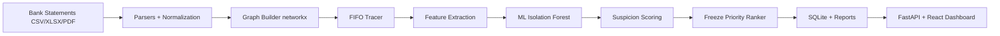

# FINTRACE - Financial & Infrastructure Intelligence for Cyber Crime

**Rajasthan Police Hackathon 2026 - Problem Statement PS05**

FINTRACE is a unified investigation platform that combines financial trail analysis with digital infrastructure intelligence. It automates fraud investigation by: (1) reconstructing money trails from bank statements, (2) detecting mule accounts using ML, (3) clustering scam infrastructure (domains, IPs, hosting), and (4) providing AI-assisted investigation over a unified graph connecting financial and digital evidence.

## Features

- **Multi-Format Ingestion**: Parses CSV, XLSX, and PDF bank statements from different banks
- **Money-Trail Graph**: Directed weighted multigraph with proportional FIFO tracing from victim
- **ML-Based Detection**: 10+ rule-based features + Isolation Forest for mule account detection
- **Freeze Priority Ranking**: Ranks accounts by estimated recovery potential, time-criticality, and downstream reach
- **Cross-Case Linking**: Identifies repeat offenders across multiple cases
- **PDF Reports**: Generates investigation reports with freeze request letter templates

## Quick Start

### One-Command Setup

```bash
make setup
make data
make run
```

Then open:
- **Backend API**: http://localhost:8000/docs
- **Frontend**: http://localhost:3000

## Manual Setup

### Backend

```bash
# Install Python dependencies
pip install -r requirements.txt

# Generate synthetic fraud data
python scripts/generate_data.py

# Start FastAPI server
cd backend/api
python main.py
```

### Frontend

```bash
cd frontend
npm install
npm run dev
```

## Demo Instructions (< 5 minutes)

1. **Generate Data** (if not already done):
   ```bash
   python scripts/generate_data.py
   ```
   Creates 3 fraud cases in `sample_data/` with ground truth

2. **Start Servers**:
   ```bash
   # Terminal 1: Backend
   python -m uvicorn backend.api.main:app --reload --port 8000

   # Terminal 2: Frontend
   cd frontend && npm run dev
   ```

3. **Demo Flow**:
   - Open http://localhost:3000
   - Click "Upload Statements" tab
   - Upload files from `sample_data/case_001/` (CSV, XLSX, PDF)
   - Click "Analyze Case"
   - Switch to "Dashboard" tab to view:
     - Transaction graph (color-coded by suspicion)
     - Suspicious accounts with explanations
     - Freeze priority rankings
     - Recovery curve
   - Click "Download PDF Report"

## API Endpoints

| Endpoint | Method | Description |
|----------|--------|-------------|
| `/cases` | POST | Create new case |
| `/cases` | GET | List all cases |
| `/cases/{id}/upload` | POST | Upload statement files |
| `/cases/{id}/analyze` | POST | Run full analysis pipeline |
| `/cases/{id}/graph` | GET | Get transaction graph JSON |
| `/cases/{id}/suspects` | GET | Get suspicious accounts |
| `/cases/{id}/freeze-priority` | GET | Get freeze priority rankings |
| `/cases/{id}/report` | GET | Download PDF report |
| `/accounts/{acc}/linked-cases` | GET | Cross-case linking |

Full API docs: http://localhost:8000/docs

## Architecture



## Tech Stack

**Backend**:
- Python 3.11+, FastAPI, pandas, networkx, scikit-learn
- pdfplumber, openpyxl, ReportLab, SQLite (SQLAlchemy)

**Frontend**:
- React, Vite, Tailwind CSS
- Cytoscape.js (graph viz), Recharts (recovery curve)

**Tests**: pytest

## Project Structure

```
tracefreeze/
├── backend/
│   ├── ingest/        # Statement parsers (CSV, XLSX, PDF)
│   ├── graph/         # Money-trail graph + FIFO tracer
│   ├── detection/     # Feature extraction + ML + scoring
│   ├── priority/      # Freeze priority ranker
│   ├── reports/       # PDF generation
│   ├── api/           # FastAPI endpoints
│   └── db/            # SQLAlchemy models + case storage
├── frontend/
│   └── src/
│       ├── pages/     # Cases, Dashboard, Upload
│       └── components/# Graph, Timeline, FreezeTable
├── scripts/
│   ├── generate_data.py  # Synthetic fraud generator
│   └── evaluate.py       # Detection metrics
├── sample_data/       # Generated test cases
├── docs/
│   └── APPROACH.md    # Technical approach for judges
└── Makefile
```

## Detection Features

1. **Pass-Through Ratio**: Outflow / Inflow (mules: 95-100%)
2. **Median Holding Time**: Minutes (mules: < 60 min)
3. **Fan-In / Fan-Out**: Number of unique sources/targets
4. **Velocity**: Total flow / time window (amount/hour)
5. **Round Number Ratio**: % of round-number transactions
6. **Cash-Out Exposure**: % to ATM/crypto/external
7. **Cycle Participation**: Round-tripping detection
8. **Dormant-Then-Active**: Sudden activation pattern
9. **Balance Ratio**: Remaining / total inflow
10. **ML Anomaly Score**: Isolation Forest (contamination=0.15)

**Combined Score**: 0-100 with human-readable explanations

## Evaluation

Run detection metrics against ground truth:

```bash
python scripts/evaluate.py
```

Outputs precision, recall, F1 for each case.

## Assumptions & Limitations

**Assumptions**:
- **Proportional FIFO Tracing**: Money is fungible (industry-standard for AML)
- **Contamination Rate**: Assumes ~15% of accounts in fraud graph are mules
- **Account Identification**: Inferred from filenames/narration when not explicit

**Limitations**:
- No real-time bank API integration (future: NPCI/I4C integration)
- No GPU-accelerated deep learning (runs on CPU for local demo)
- PDF parsing accuracy depends on statement format consistency

## Future Work

- Real-time alerts when new transactions hit frozen accounts
- Integration with NPCI for live statement pulls
- Collaboration portal for multi-jurisdiction cases
- Mobile app for field investigators
- Advanced NLP for narration analysis

## License

MIT License - Built for Rajasthan Police Hackathon 2026

## Contact

For questions or demo requests: [Your Contact]

---

**Demo Time**: < 5 minutes setup, < 2 minutes to impress judges ✓
